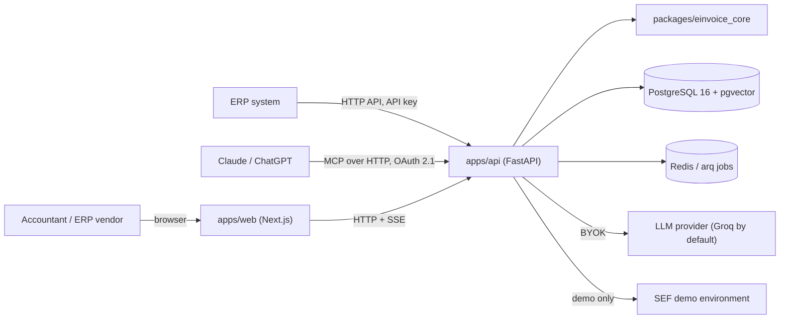

# Architecture

This document is the map of the system: what the pieces are, how data flows between them and
where each concern lives in the repository. It is kept current in the pull request that
changes the architecture; decisions and their trade-offs are recorded separately in
[`adr/`](adr/README.md). The product and engineering charter is [`BRIEF.md`](BRIEF.md).

Status: milestone M1 in progress. Sections marked *planned* describe the target shape and are
filled in as the milestones land.

## System context

## The three layers (ADR-0002)

| Layer | Component | Trusts | Produces |
| --- | --- | --- | --- |
| 1 · Deterministic validator | `packages/einvoice_core` | XSD, EN 16931 + Peppol BIS Schematron, SRB-CIUS rules in code | `Violation {rule_id, severity, xpath, message}` |
| 2 · Explainer | `apps/api` (`rag`) | retrieved regulation chunks only | explanation (sr / en) with citations that must resolve |
| 3 · Repairer | `apps/api` (`repair`) + `einvoice_core` patch engine | patches as data, applied by code, re-validated by layer 1 | diff for human approval |

The language model sits between two deterministic walls and is never trusted; nothing leaves
the system without a green validator.

## Request flow (target, M2–M3)

1. Upload (`POST /invoices`) — size and type limits, hardened XML parsing (no DTD, no external
   entities). In no-store mode the bytes never touch the database.
2. Validate — a job on `arq` behind the `JobRunner` interface; progress events over SSE.
   Layer 1 runs XSD → Schematron (compiled once, cached) → SRB-CIUS rules → arithmetic.
3. Explain — for each violation: curated `rule_id → passages` map first, then pgvector
   similarity and `pg_trgm` keyword retrieval; the model writes the explanation with
   structured output; citations are checked against stored chunk ids.
4. Repair — the model proposes patches; the forbidden-field guard rejects anything touching
   amounts, VAT, tax identifiers or dates of supply; code applies the rest; layer 1 re-validates;
   the user sees a diff and approves; every step is written to the audit log.
5. Send — the approved invoice goes to the SEF demo environment; status is polled; SEF error
   codes feed back into the same explanation pipeline.

## Repository map

| Path | Responsibility | Status |
| --- | --- | --- |
| `packages/einvoice_core` | parser, XSD, Schematron runner, SRB-CIUS rules, arithmetic, patch engine, CLI | M1 in progress: semantic model, hardened XML loading, UBL 2.1 parser, violation model, UBL 2.1 XSD validation, EN 16931 and Peppol BIS Schematron, SRB-CIUS rule set v1 (29 rules, ADR-0006) |
| `apps/api` | HTTP API, auth and multi-tenancy, jobs, retrieval, explainer, repairer, SEF client, MCP server | M0 skeleton (`/health`, `/ready`) |
| `apps/web` | upload, report, explanations, diff and approval UI (sr-Latn / en) | M0 skeleton |
| `third_party/` | fetched UBL 2.1 schemas, EN 16931 and Peppol BIS artefacts, the ISO Schematron compiler, with their terms; compiled-stylesheet cache | M1 (UBL 2.1 and ISO Schematron added) |
| `corpus/` | regulation texts from official sources with `source_url`, `fetched_at`, `valid_from` | planned (M2) |
| `fixtures/invoices/` | synthetic invoices (official examples are used from `third_party/`); never real company data | M1 in progress |
| `evals/` | golden sets, runner, thresholds, latest report | planned (M6) |
| `infra/` | docker-compose for local PostgreSQL and Redis; Dockerfiles and deployment manifests | M0 (compose) |
| `scripts/` | rule-set fetcher, fixture generator, hook helpers | M0 |
| `docs/` | brief, this document, ADRs, learning and interview notes, API docs | M0 |

## Cross-cutting concerns

- **Multi-tenancy:** every table carries `organization_id`; row-level access is enforced in the
  service layer and covered by tests that attempt cross-tenant reads. *(planned, M2)*
- **No-store mode:** an invoice can be processed entirely in memory; nothing about its content
  reaches logs, traces, metrics or error reports in either mode.
- **Configuration:** environment variables only (`.env.example` lists the names); secrets are
  never committed; tenant SEF keys are encrypted at rest with Fernet.
- **Observability:** structured JSON logs with request ids, OpenTelemetry traces to Langfuse
  (LLM cost per invoice), Sentry for errors. *(planned, M2)*
- **Quality gates:** `pre-commit` locally and in CI (ADR-0001); coverage gates (core ≥ 90 %,
  API ≥ 80 %); evaluation thresholds gate CI from M6.
- **Deployment:** free tiers only — Render (API), Neon (PostgreSQL), Upstash (Redis),
  Cloudflare Pages (web), GitHub Actions and GHCR. Cold starts are expected and shown in the UI.
  *(planned, M3)*
