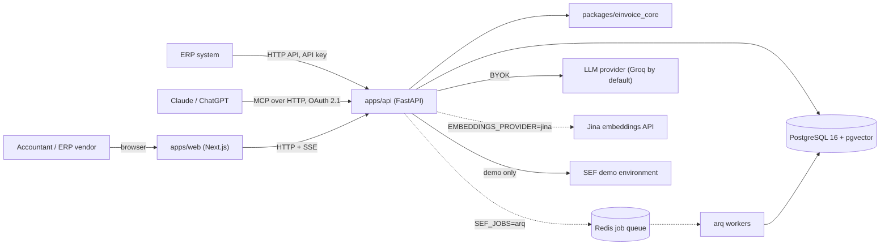

# Architecture

This document is the map of the system: what the pieces are, how data flows between them and
where each concern lives in the repository. It is kept current in the pull request that
changes the architecture; decisions and their trade-offs are recorded separately in
[`adr/`](adr/README.md). The product and engineering charter is [`BRIEF.md`](BRIEF.md).

Status: milestones M0 to M5 done (`v0.5.0`), M6 next. Sections marked *planned* describe the
target shape and are filled in as the milestones land.

## System context

## The three layers (ADR-0002)

| Layer | Component | Trusts | Produces |
| --- | --- | --- | --- |
| 1 · Deterministic validator | `packages/einvoice_core` | XSD, EN 16931 + Peppol BIS Schematron, SRB-CIUS rules in code | `Violation {rule_id, severity, xpath, message}` |
| 2 · Explainer | `apps/api` (`rag`) | retrieved regulation chunks only | explanation (sr / en) with citations that must resolve |
| 3 · Repairer | `apps/api` (`repair`) + `einvoice_core` patch engine | patches as data, applied by code, re-validated by layer 1 | diff for human approval |

The language model sits between two deterministic walls and is never trusted; nothing leaves
the system without a green validator.

## Request flow (target, M2–M3)

1. Upload (`POST /invoices`) — limits on bytes, time and elements, hardened XML parsing (no DTD,
   no external entities). In no-store mode (`POST /invoices/validate`, ADR-0015) the bytes
   never touch the database.
2. Validate — in a child process of the API, one invoice at a time, stopped at a time limit
   (ADR-0015). Layer 1 runs XSD → Schematron → SRB-CIUS rules → arithmetic, in one call per
   profile (`srb`, `en16931`, `peppol`) that reports what a profile sets aside and why. Work
   that outlasts a request runs as a job (ADR-0019): its row in PostgreSQL is the truth, and it
   runs in the API's event loop or in arq workers on a Redis queue, behind the `JobRunner`
   interface, with its progress streamed over SSE (`GET /jobs/{id}/events`). The first job
   validates stored invoices again with the current rules (`POST /invoices/revalidations`);
   sending to SEF follows.
3. Explain (`POST /invoices/explain`, ADR-0021) — for each rule of the report, from its first
   violation: the passages the rule is authored from (ADR-0020), the specification's rows of
   the terms it names and of its place, the tax categories and codes it names, then `pg_trgm`
   words and pgvector meaning fused by rank, among the passages that apply on the invoice's
   day. The model answers a JSON schema whose citations can only be those passages' ids; the
   answer is checked again and sent back with the reason when it fails, three answers at most,
   and the response is built from the stored passages.
4. Repair — the model proposes patches `{xpath, op, value, reason}`, each at the canonical path
   of a violation (ADR-0023). The guard refuses any that touches an amount, VAT, a tax or company
   identifier, a date or the document's number, as needing a person's decision; code applies
   the rest where the UBL schema orders them; layer 1 validates the result under the same
   profile; the user sees a diff and approves; every step is written to the audit log. The
   patch engine is in the core (`einvoice patch`). A repair of a stored invoice is proposed by
   a member or an API key and applied to a copy in the validator's child process (ADR-0024);
   only a person approves it, onto the document it was proposed for, within the quota. The
   model proposes one on request (`POST /invoices/{id}/repairs/suggestion`, ADR-0025): it is
   sent the fatal violations and the invoice's fields around them, by canonical path; every
   answer is checked before it is applied; the validator's process applies each round and
   tells the model what became of each patch, two rounds at most within 20 s.
5. Send — a stored invoice that the validator passes under SRB-CIUS goes to the SEF demo
   environment with the organization's key, byte for byte as validated and once, through its
   request id (ADR-0050, ADR-0051); where the jobs run, the API asks SEF where it stands until
   it is final. An owner or an accountant sends it from the report's page, an assistant through
   the scope it asks for when it first sends (ADR-0052), an ERP with a key that holds sending
   (ADR-0053). SEF's error codes are to feed back into the same explanation pipeline
   *(planned: they wait for a SEF demo account)*.

## Repository map

| Path | Responsibility | Status |
| --- | --- | --- |
| `packages/einvoice_core` | parser, XSD, Schematron runner, SRB-CIUS rules, arithmetic, patch engine, CLI | M1 (`v0.1.0`): semantic model, hardened XML loading, UBL 2.1 parser, violation model, UBL 2.1 XSD validation, EN 16931 and Peppol BIS Schematron, SRB-CIUS rule set v1 (29 rules, ADR-0006), BR-CO arithmetic in Python (ADR-0007), validation pipeline with profiles (ADR-0008), `einvoice` CLI (ADR-0009), hostile documents: linear addressing, bounded numbers and reports, values read whole (ADR-0014). M3: the patch engine, with places named by canonical paths, the schema's order, the guard of the fields a person decides, and a repair that validates again and shows a diff, also as `einvoice patch` (ADR-0023); the fields around a place, which a repairer is shown (ADR-0025) |
| `apps/api` | HTTP API, auth and multi-tenancy, jobs, retrieval, explainer, repairer, SEF client, MCP server | M2 (`v0.2.0`): settings, PostgreSQL with Alembic migrations, the tenancy schema (ADR-0011), accounts, sign-in and tokens (ADR-0012), permissions, members and invitations (ADR-0013), invoice validation in a child process (ADR-0015), stored invoices with their reports, seen by organization and submitter, within a quota, listed by verdict (ADR-0016), API keys that act for a member within their role (ADR-0017), rate limits per address, account, caller and organization (ADR-0018), jobs with fenced attempts that continue from their progress, inline or on arq workers, followed over SSE, and the first of them, validating stored invoices again (ADR-0019); the corpus in PostgreSQL with pgvector and trigram indexes, its idempotent ingest with optional embeddings, and the passages each rule cites (ADR-0020); explanations of a report's rules in Serbian or English, from passages found by rule, term, place, code, words and meaning, through a language model behind `LLMClient` (Groq by default) whose citations are held to those passages (ADR-0021); `/health`, `/ready` (database and validator). M3: repairs of stored invoices proposed as patches, applied to a copy in the validator's child process and kept with what they did, approved or rejected by a person only, and an audit log without invoice content (ADR-0024); every request body other than an invoice bounded; repairs the language model proposes, from the fields around the violations, checked before they are applied, in two rounds (ADR-0025); explanations of a stored invoice's report, which is not validated again (ADR-0029); the API as an image, its rule sets compiled in and its migrations applied when it starts (ADR-0034); an unexpected failure answered inside the CORS middleware; `/health` saying whether the server is the public demo (ADR-0037) (`v0.3.0`). M4: the MCP server at `/mcp`, in the API's process and without sessions (ADR-0042), its tools on invoices, explanations, repairs and the rule catalogue read from the rule sets (ADR-0047); the API's own authorization server for public clients, with PKCE, resource indicators, client metadata documents fetched only where allowed, and the step-up for a tool's scope (ADR-0044 to ADR-0046); finished jobs and stored invoices deleted past their retention (ADR-0038, ADR-0039); explanations kept with a stored invoice's report (ADR-0040) and what the rules say embedded once (ADR-0041); security events, the time each API key was last used, error reports and the model's traces that hold nothing a person sent (ADR-0048, ADR-0049) (`v0.4.0`). M5: an organization's key to SEF, sealed with Fernet for that organization alone and rotated with a command (ADR-0050); the SEF demo client over SEF's public API, a stored invoice sent only when the validator passes it, once through its request id, and watched until final where the jobs run (ADR-0051); the scope `invoices:send`, asked for when an assistant first sends, the MCP tools `send_to_sef_demo` and `get_sef_status`, and the scopes a person's role withholds named on the consent request (ADR-0052); API keys that may send (ADR-0053) (`v0.5.0`). M6: OpenAI's chat completions and Anthropic's Messages API beside Groq's behind `LLMClient`, one retrying client for the three, chosen by `LLM_PROVIDER` (ADR-0057); an organization's own key to a model, sealed as its SEF key, whose model then writes its explanations and repairs (ADR-0058) |
| `apps/web` | upload, report, explanations, diff and approval UI (sr-Latn / en) | M3 (`v0.3.0`): the shell. Every page in Serbian (Latin) and English, the language first in its path and each page rendered once per language; shadcn/ui components (`new-york`, Radix) in the repository; dark mode from the operating system; the API called from the browser through TanStack Query, and its status in the footer (ADR-0026); registration, sign-in and sign-out, with the access token in memory and the refresh token in local storage, refreshed by one tab at a time (ADR-0027); the invoices: upload, the list and the report, typed from the API's OpenAPI document that the repository keeps, and the report's page a static shell with the invoice's id streamed into it (ADR-0028); the rules' explanations with their citations, when the visitor asks (ADR-0029); the invoice's repairs, and each repair's page with what became of its patches, the API's diff and the report on the copy it leaves (ADR-0030); a repair asked of the language model from the report, refused for a reason the API names (ADR-0031); a person's approval or rejection on the repair's page, asked twice for an approval, and the repair read again when the outcome is unknown (ADR-0032); the golden path walked in Chromium by one Playwright test, against the production build and the API on a database of its own with a scripted model (ADR-0033); the requests wait for a sleeping API, which the footer and a notice above the page say is waking up (ADR-0036); on the public demo, which `GET /health` names, the upload asks for synthetic invoices only (ADR-0037). M4: the brand's look as tokens whose contrast is tested (ADR-0043); the home page as the product's page; the organization's page, with its retention period and the member's API keys; the page where a person lets an MCP client act for them, or not, naming the host that published it; a picture or a PDF told for what it is (`v0.4.0`). M5: the organization's key to SEF, set, replaced or removed by its owner in a field that forgets it once saved; the report's page, which sends a valid invoice to SEF after a second press and says where it stands there, read again while the API asks SEF; the consent page naming apart what the person's role withholds; the API keys that may send (`v0.5.0`) |
| `third_party/` | fetched UBL 2.1 schemas, EN 16931 and Peppol BIS artefacts, the ISO Schematron compiler, with their terms; compiled-stylesheet cache | M1 (UBL 2.1 and ISO Schematron added) |
| `corpus/` | the official documents explanations cite, as Markdown editions written by `scripts/build_corpus.py` from sources pinned by URL and SHA-256 in `manifest.toml` (the law and the rulebook on e-invoicing, the PIB rulebook, the SRB-CIUS specification, the tax categories); passages dated by edition, deferral and renumbering, and loaded with embeddings into `corpus_passages` (ADR-0020) | M2 |
| `fixtures/invoices/` | the Ministry's SEF examples (byte for byte, with provenance), synthetic invoices and generated mutations, the pipeline's recorded verdicts (ADR-0010); CEN's and OpenPeppol's examples are used from `third_party/`; never real company data | M1 |
| `evals/` | golden sets, runner, thresholds, latest report | M6: the workspace package `sef-kopilot-evals` and `sef-evals`, which measures the validator on every document of the corpus against golden labels and against the published rule sets applied as published, judges the measures against `evals/thresholds.yaml` and writes the committed report (ADR-0054); the explanations of the mutations' rules, as the API writes them on a database of the evaluations' own, with the model's answers recorded once and replayed (cassettes), their citations resolved and labelled relevant by a person (ADR-0055); repairs of held-out invoices, which must pass, and of invoices whose mistake a person decides, which must not (ADR-0056) |
| `infra/` | docker-compose for local PostgreSQL and Redis; Dockerfiles and deployment manifests | M0 (compose) |
| `scripts/` | rule-set fetcher, fixture generator, corpus converter, hook helpers, the API of the end-to-end test (ADR-0033) | M0 |
| `docs/` | brief, this document, ADRs, learning and interview notes, API docs | M0 |

## Cross-cutting concerns

- **Multi-tenancy:** every table that holds a tenant's data carries `organization_id`; people are
  global and belong to organizations through memberships with a role. Row-level access is
  enforced in the service layer and covered by tests that attempt cross-tenant requests
  (ADR-0011; every guarded endpoint has a cross-tenant test, ADR-0013).
- **Background work:** a job's row is the truth and a queue carries only its id; taking a job
  on counts an attempt, every later write requires the attempt to be the latest, and progress
  is written with the work it counts, so that a job delivered twice does its work once
  (ADR-0019).
- **No-store mode:** an invoice can be processed entirely in memory; nothing about its content
  reaches logs, traces, metrics or error reports in either mode.
- **The corpus:** official text in the repository, generated and checked against pinned sources,
  which a weekly job downloads afresh to find a text a publisher changed; passages carry the
  days they apply, and an id that names the first, so a citation never changes meaning. It is
  public data shared by every organization, so its tables carry no `organization_id`; only the
  ingest command writes them, and nothing leaves the server to embed it unless
  `EMBEDDINGS_PROVIDER` says so (ADR-0020).
- **The language model:** untrusted, and asked only about violations layer 1 reported in the
  same request. It is sent the first violation of each rule and public passages, never the
  document; an embedder is sent what the rules say, never what the invoice holds. Nothing
  leaves the server unless `LLM_PROVIDER` says so (ADR-0021): Groq, OpenAI or Anthropic, with the
  operator's key (ADR-0057), or unless an organization's owner set a key of its own, and then
  only to that provider, never to the server's instead (ADR-0058).
- **Configuration:** environment variables only (`.env.example` lists the names); secrets are
  never committed; tenants' SEF keys and keys to a model are encrypted at rest with Fernet.
- **Observability:** structured JSON logs in a deployment, each line naming its request, and
  security events (sign-ins, keys, consents, repairs decided); unexpected errors reported to
  Sentry without what a person sent (ADR-0048); each request to the language model traced to
  Langfuse as OpenTelemetry, its model, time and tokens without the conversation (ADR-0049); each
  only where the operator sets its keys.
- **Quality gates:** `pre-commit` locally and in CI (ADR-0001); coverage gates (core ≥ 90 %,
  API ≥ 80 %); one end-to-end test of the golden path in a browser, against the API with a
  scripted model, on every pull request (ADR-0033); the evaluations' thresholds
  (`evals/thresholds.yaml`, ADR-0054), which the committed report must meet.
- **Deployment:** free tiers only (ADR-0035) — Vercel (web), Render (API, the image of
  ADR-0034), Neon (PostgreSQL), GitHub Actions; Upstash (Redis) once there are workers. The free
  API sleeps after 15 minutes and wakes in about a minute, while the pages wait for it and say
  so (ADR-0036). `docs/DEPLOY.md` is the runbook.
