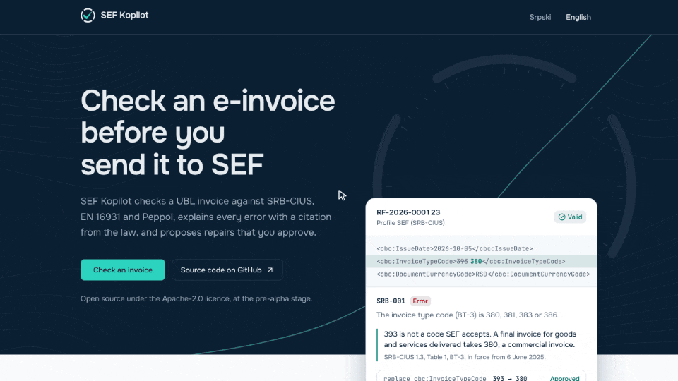
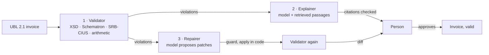

# Case study: SEF Kopilot

SEF Kopilot checks the electronic invoices Serbian businesses send through SEF (Sistem
elektronskih faktura), explains every error with a dated citation from the regulation, and
proposes repairs that a person approves. It is built around one rule: a language model may
explain and suggest, but a deterministic validator decides, and nothing the model writes is
trusted until code has checked it. This page tells how the system came to be what it is: the
problem, the decisions and their trade-offs, what went wrong on the way, and what the numbers
say now. Every claim links to the code, a decision record or a report that backs it.

| | |
| --- | --- |
| **Problem** | SEF rejects an invoice with a rule identifier; the rules come from three sources and keep changing |
| **Who for** | Accountants, ERP vendors, and invoicing software facing the EU's e-invoicing mandates |
| **What it does** | Validates UBL 2.1 against SRB-CIUS, EN 16931 and Peppol BIS; explains; repairs with approval; sends to SEF's demo; reads PDFs and pictures (beta); all of it over HTTP and MCP |
| **Stack** | Python 3.12, FastAPI, PostgreSQL 16 with pgvector, Saxon-HE, Next.js, TypeScript |
| **Quality gates** | 1,770 core tests at 100 % coverage, 1,603 API tests at 99 %, 581 web tests, one end-to-end test, evaluations that fail CI below their thresholds |
| **History** | 109 pull requests, 64 architecture decision records, six releases since the first commit on 3 November 2026 |

## 1. The problem

Every invoice between Serbian businesses passes through SEF as UBL 2.1 XML, and it has to
satisfy SRB-CIUS, the Serbian profile of the European standard EN 16931. When SEF rejects one,
the sender gets a rule identifier such as `BR-CO-15` or `SRB-008`, or a terse error code.
Someone then has to work out what is actually wrong, which regulation says so, and what to
change. From 1 January 2027 SEF also derives the preliminary VAT return from these invoices, so
a wrong VAT category stops being a formatting problem and becomes a tax problem.

Three things make this harder than it looks:

- **The rules come from three places, each with its own lineage.** The UBL schema is OASIS's.
  The EN 16931 and Peppol BIS business rules are published by CEN and OpenPeppol as Schematron.
  SRB-CIUS, the Serbian part, exists only as a specification document: there is no Schematron
  for it anywhere.
- **The rules move.** The Serbian law changed in December 2025, the rulebook on 1 August 2026,
  and the technical instruction on 1 October 2026. An explanation is only right if it cites the
  text that applied on the invoice's issue date.
- **A confident wrong answer is expensive.** A language model explains fluently and is wrong
  sometimes. On a tax document, "sometimes" is not acceptable, and a model that edits amounts or
  tax identifiers is a liability.

## 2. The rule that shaped everything

The model sits between two deterministic walls ([ADR-0002](adr/0002-deterministic-validator-is-the-source-of-truth.md)).
The validator decides what is valid and never asks the model. The explainer may cite only the
passages retrieval returned; a citation that does not resolve to a stored passage fails the
answer. The repairer may only emit patches; code applies them on a copy, the validator judges
the result, and a person approves the diff. These are not comments in a design document: each
guardrail is a test that fails if it is broken.

## 3. Decisions and their trade-offs

Sixty-four decisions are recorded as ADRs in [`docs/adr/`](adr/README.md). These are the ones
that shaped the system most.

**Run the published rules as published.** The EN 16931 and Peppol rules could have been
re-implemented in Python, which would have been faster to run and easier to debug, and would
have drifted from the official rules with every release. Instead the official artefacts run
in-process with Saxon-HE: CEN's compiled XSLT, and Peppol's Schematron compiled by the ISO
reference pipeline. The pipeline was checked against CEN's own XSLT: CEN's Schematron, compiled
by it, reports exactly what CEN's stylesheet reports on all 1,131 documents of CEN's test suite
([ADR-0005](adr/0005-schematron-runner.md)). Rule sets are fetched by their pins and never
modified.

**Write SRB-CIUS in code, one rule per file.** With no Schematron to run, the 29 Serbian rules
are Python, each citing the paragraph of the specification it comes from, each with an invoice
that passes and one that fails ([ADR-0006](adr/0006-srb-cius-rules-in-python.md)). Where the
specification and the Ministry's own examples disagree, the profile sets the EN 16931 rule
aside and says why: `einvoice rules --profile srb` lists every such decision.

**Do arithmetic in Python, not in XPath and never in the model.** The `BR-CO` rules (line totals,
VAT breakdown, amount due) run in Python with an exact decimal context
([ADR-0007](adr/0007-calculation-rules-in-python.md)). Python's default context silently rounds
beyond 28 digits; a test with 28-digit amounts that add up pins the difference.

**Validate in a child process, not a thread.** The first version validated in a worker thread.
An independent review measured one client stalling every other request, sign-ins included, for
5 seconds with one document and 42 seconds with seven, because Saxon holds Python's GIL. A
child process with a time limit fixed it: `/health` now answers within 5 ms while a validation
runs into its limit ([ADR-0015](adr/0015-validating-invoices-through-the-api.md)). The price is
memory: a warm child holds about 210 MiB, and memory, not bytes, sets the limits on what an
invoice may contain.

**Treat every document as hostile.** The parser expands no entity, reads no DTD and opens no
socket, and tests pin all three. Measuring the worst cases found a quadratic path computation:
an invoice of 8,000 lines took 39 seconds to validate, and takes 5 now
([ADR-0014](adr/0014-hostile-documents-in-the-core.md)).

**Cite dated passages, and check every citation.** The regulations are stored as text, passage
by passage, each edition with the day it applies from: five documents, seven editions, 385
passages ([`corpus/`](../corpus/README.md), [ADR-0020](adr/0020-corpus-of-official-documents.md)).
Retrieval starts from a curated map of each rule to the passages it is authored from, then adds
trigram and, optionally, vector matches, among the passages in force on the invoice's day. The
model answers a JSON schema whose citations can only be those passages' ids; an answer that
fails is sent back with the reason, three times at most
([ADR-0021](adr/0021-explanations-and-their-citations.md)).

**An explanation names no value of its own.** The first live explanation, of a PIB with a wrong
check digit, was right about the rule and the citation, and then offered a corrected PIB "for
example". A value the model invents looks exactly like a value it read, and a PIB with one digit
changed is another taxpayer's. Answers are now checked in code: every date, amount, rate or long
number an explanation names must occur in what the model was sent, the violation's message, its
place, the invoice's day or the passages, or the answer goes back to the model
([ADR-0022](adr/0022-explanations-name-no-value-of-their-own.md)).

**Repairs are patches, and some fields belong to a person.** The model proposes
`{xpath, op, value, reason}` at the place of a violation. A guard refuses any patch that touches
an amount, a VAT rate or category, a tax or company identifier, a date or the document's number,
and surfaces it as needing a person's decision. Code applies the rest in the schema's order, the
validator judges the copy, a person approves the diff, and every step is written to an audit log
([ADR-0023](adr/0023-patches-and-the-fields-a-person-decides.md),
[ADR-0024](adr/0024-repairs-of-stored-invoices-and-the-audit-log.md)).

**Put the MCP server inside the API.** Assistants such as Claude and ChatGPT reach the same
service layer the web application uses, through 16 tools at `/mcp`, behind an OAuth 2.1
authorization server of the API's own: PKCE, protected resource metadata (RFC 9728),
authorization server metadata (RFC 8414), resource indicators (RFC 8707) and dynamic client
registration (RFC 7591). Sending to SEF is a separate scope that a client asks for when it needs
it ([ADR-0042](adr/0042-the-mcp-server-lives-in-the-apis-process.md),
[ADR-0044](adr/0044-the-mcp-endpoints-authorization-server.md),
[ADR-0046](adr/0046-an-mcp-client-steps-up-for-a-tools-scope.md)). [`DEMO.md`](DEMO.md) shows
both assistants on a synthetic invoice.

**Measure the system, and let the measurements fail the build.** The evaluations run the
validator on golden documents against the published rule sets, and replay recorded answers of
the model for explanations, repairs and reading, so CI is deterministic and free
([ADR-0054](adr/0054-the-system-is-measured-on-golden-sets-against-thresholds.md),
[ADR-0055](adr/0055-the-models-answers-are-recorded-once-and-replayed.md)). A threshold missed
fails CI ([ADR-0061](adr/0061-the-evaluations-gate-ci-and-the-badge-reads-the-committed-report.md)).

**Read PDFs and pictures, but only into fields a person confirms.** The beta reads a PDF, a scan
or a photograph into an invoice's fields, shown beside the document for a person to check. Code,
not the model, then writes the UBL of the confirmed fields, computing nothing and filling in
nothing ([ADR-0062](adr/0062-invoices-are-read-from-pdfs-and-pictures-into-fields-a-person-confirms.md)).
The reading is measured on ten synthetic invoices printed three ways
([ADR-0063](adr/0063-the-reading-is-measured-on-invoices-printed-three-ways.md)).

## 4. What went wrong, and what it changed

- **Constrained decoding answered null.** Asked for amounts as text under a strict JSON schema,
  the reading model on Groq wrote every amount as null, since its decoding could only start a
  value with a quote or with `null`. It read 24 % of the PDFs' fields. Amounts are now asked
  for as JSON numbers and parsed digit for digit into text, and the recording that followed
  read 100 % of them.
- **A thread was the wrong boundary for Saxon.** Covered above: the review that measured the
  stalls also found schema-valid documents that crashed the validator or made Saxon print
  invoice data to its error stream. Saxon's output now goes nowhere, and the limits are
  measured in elements and memory.
- **A free model's daily limit stopped a recording twice.** Reading thirty documents, a picture
  in every request, used up Groq's free daily quota. Gemini was added as a provider, and one
  provider can now read while another writes (`SEF_EXTRACTION_PROVIDER`).
- **The outside world said no twice.** SEF's demo environment requires an eID registration and
  a company administrator's role, which the project does not have, so sending is tested against
  SEF's published API, and the work that needs an account waits after 1.0. Stripe does not take
  payments for businesses in Serbia, so credits are bought only in Stripe's sandbox, behind an
  interface ([ADR-0060](adr/0060-credits-are-bought-through-stripes-sandbox-behind-an-interface.md)).
- **Recording this page's demo found a flaw.** After a repair is approved, the report shows the
  invoice's previous verdict for a moment before the fresh one arrives. It is in the backlog as
  a fix of its own.

In sixteen working sessions, faults were seeded into the code just changed, to check that the
tests catch them; a fault they missed got a test of its own.

## 5. Results

Measured by `make evals` and committed in [`evals/reports/latest.md`](../evals/reports/latest.md):

| What is measured | Result | Threshold |
| --- | --- | --- |
| Verdicts that agree with the published rule sets, applied as published | 100 % (93 of 93 documents) | 100 % |
| Documents that must be rejected, accepted | 0 % (0 of 56) | 0 % |
| Mistakes reported by the rules they must be reported by | 100 % (60 of 60) | 100 % |
| Rules of the golden documents the model explained | 100 % (47 of 47) | ≥ 90 % |
| Citations that resolve to a stored passage in force on the day | 100 % (93 of 93) | 100 % |
| Citations labelled relevant to their rule | 96.8 % (90 of 93) | ≥ 90 % |
| Held-out invoices a repair leaves valid | 100 % (9 of 9) | ≥ 80 % |
| Invoices whose mistake a person decides, made to pass by a repair | 0 % (0 of 11) | 0 % |
| Fields read as printed: PDF, scan, photograph | 100 %, 99.5 %, 99.8 % | ≥ 97, 95, 90 % |
| Fields the reading invented | 1.9 % (2 of 108) | ≤ 5 % |

Against the brief's performance budget: validating a typical invoice takes 13 ms warm through
the API and 6.5 ms in the core (budget 500 ms); the first live explanation took 1.5 s for the
whole request (budget 6 s); a repair suggestion takes about 40 ms of the system's own time, and
the rest of its 20 s budget is the model's.

The public demo runs on free plans only: the web application on Vercel, the API on Render, the
database on Neon and the model on Groq ([`DEPLOY.md`](DEPLOY.md)). A self-hosted deployment
makes no call outward except to the model provider its operator chooses.

## 6. How it was built

SEF Kopilot is built by its maintainer, Marko Spasojević, working with an AI coding assistant as
a pair-programming partner, under a written working agreement
([`CONTRIBUTING.md`](../CONTRIBUTING.md), [`AGENTS.md`](../AGENTS.md)). The maintainer reviews,
pushes, opens and merges every change. The process is part of the product:

- One branch per change, a pull request for each, merged as a merge commit after CI passes, so
  `git log --graph` reads as the project's story: 109 pull requests merged to date.
- A decision record for every architectural choice, written when the choice is made.
- Interview notes in every pull request: three questions a senior engineer would ask, with
  answers, and one concept the maintainer explains without notes ([`interview/`](interview/README.md)).
- A one-page learning note for every new concept ([`learning/`](learning/README.md)), and an
  engineering log of every session ([`SESSIONS.md`](SESSIONS.md)), findings included.

| Release | Date | Milestone |
| --- | --- | --- |
| 0.1.0 | 4 November 2026 | Validator core: parser, schema, Schematron, SRB-CIUS, arithmetic, CLI |
| 0.2.0 | 6 November 2026 | API, persistence, authentication, jobs, corpus, explanations with citations |
| 0.3.0 | 7 November 2026 | Repairs with approval and audit log, web application, public demo |
| 0.4.0 | 8 November 2026 | MCP server with OAuth 2.1, shown from Claude and ChatGPT |
| 0.5.0 | 9 November 2026 | Sending to SEF's demo environment |
| 0.6.0 | 10 November 2026 | Evaluations as a CI gate, billing in Stripe's sandbox, more model providers |

## 7. What is next

- The release of 1.0, after a security review against the OWASP ASVS checklist of
  [`SECURITY.md`](../SECURITY.md).
- The work that waits for a SEF demo account: SEF's error codes mapped into explanations, the
  internal technical instruction in the corpus, and the rules the published documents leave
  open confirmed against SEF itself ([`BACKLOG.md`](BACKLOG.md)).
- The fresh verdict after an approval, found while recording the demo.
- Other EN 16931 markets: the validator's profiles (`srb`, `en16931`, `peppol`) already keep the
  European rules apart from the Serbian ones, so a national profile is a set of rules beside
  them.
