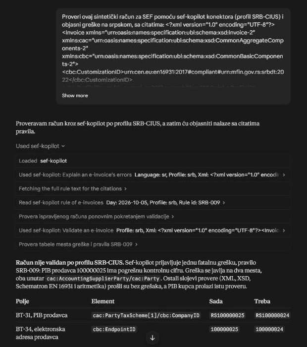
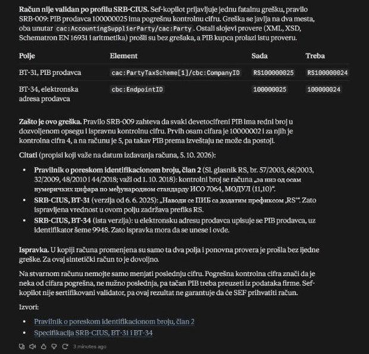
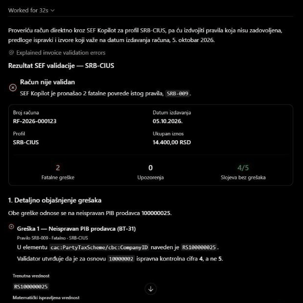
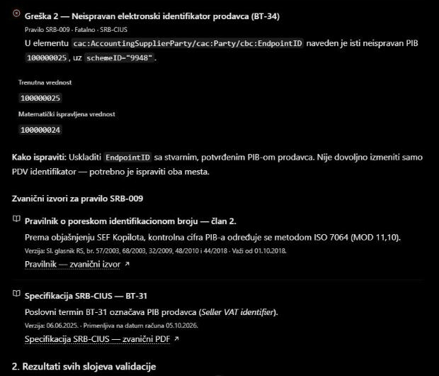

# The demo: SEF Kopilot from Claude and ChatGPT

SEF Kopilot's MCP server, `https://sef-kopilot-api.onrender.com/mcp`, is what an assistant
connects to: it validates an invoice, explains each rule it breaks with citations from the
regulation, reads the rules, and works on the organization's stored invoices, as the person who
connected it may (ADR-0042, ADR-0044 to ADR-0047). This page shows it from two assistants, on the public
demo, with a synthetic invoice. `docs/DEPLOY.md` (step 6) turns the authorization server on.

## The invoice

[`srb-009-pib-check-digit.xml`](../fixtures/invoices/synthetic/mutations/srb-009-pib-check-digit.xml),
a synthetic invoice with one mistake: the seller's PIB is 100000025 where 100000024 was meant,
so its last digit is not the check digit of the first eight. It appears twice, in the VAT
identifier (BT-31) and in the electronic address (BT-34). Everything else, the schema, EN 16931
and the arithmetic, passes.

## Claude

Connected in Claude's settings as a custom connector with the server's address; Claude registers
itself, sends the person to the web application to sign in and allow it, and lists the tools.

Asked, in Serbian, to check the invoice with the connector under SRB-CIUS and explain the errors
with citations, Claude called `explain_errors`, read the rule with `get_rule`, and validated
again with `validate_invoice`:

Its answer reports what the validator found, SRB-009 twice, and explains it from the passages
the server returned: the PIB rulebook, article 2, and SRB-CIUS on BT-31 and BT-34, each with the
dates it is in force on the invoice's issue date:

## ChatGPT

Connected in ChatGPT's developer mode (**Settings > Apps & Connectors > Advanced settings**),
as an app with the server's address and OAuth; ChatGPT registers itself in the same way, and the
person allows it on the same page of the web application.

Asked the same, with the app chosen for the chat, ChatGPT called `explain_errors`:

It lays out the same report, each violation with the value it holds and the one whose check
digit is right, and the passages the server returned, with their versions and the dates they
apply:

## What to notice

- **The validator decides, not the model.** The verdict and the rule come from the rule sets;
  the server's instructions tell the assistant to report them, not to judge.
- **Citations resolve.** Every passage cited is one the server holds, with its source and the
  dates it applies; the assistant quotes them rather than adding law of its own.
- **Scopes.** The person allowed `invoices:validate` and `invoices:submit`; a tool that needs
  more asks for it (the step-up, ADR-0046).
- **Nothing is stored** by `validate_invoice` or `explain_errors`; the language model of the
  server is sent each rule's first violation and the passages, nothing else of the invoice.
