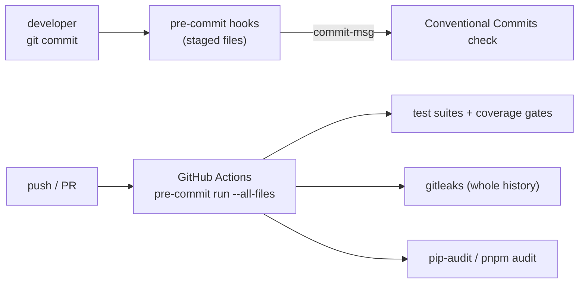

# Learning note 01 — uv workspaces, src layout and pre-commit

Three concepts behind the M0 skeleton that come up in interviews.

## 1. A uv workspace with a virtual root

```text
sef-kopilot/
  pyproject.toml            ← virtual root: no [project] table, never built
  uv.lock                   ← ONE lock file for every member
  .venv/                    ← ONE environment with every member installed (editable)
  packages/einvoice_core/   ← member: a real, buildable package
  apps/api/                 ← member: depends on einvoice-core via { workspace = true }
```

- A *workspace* is a set of Python projects resolved together: one dependency resolution, one
  lock file, one virtual environment. `uv sync --all-packages` installs every member.
- The root is *virtual*: it has `[tool.uv.workspace]`, `[dependency-groups]` and tool
  configuration, but no `[project]`, so nothing tries to build or publish "the root".
- `apps/api` declares `einvoice-core` as a normal dependency plus
  `[tool.uv.sources] einvoice-core = { workspace = true }`, which tells uv to use the local
  member instead of looking on PyPI. The dependency stays a real package: swap the source and
  the same `pyproject.toml` works against a published wheel.
- Development tools live in the root's `dev` dependency group, so there is one version of
  `ruff`, `mypy` and `pytest` for the whole repository. `ruff` is pinned exactly because the
  pre-commit hook brings its own copy and the two must agree.

**Why the src layout?** With `packages/einvoice_core/src/einvoice_core/`, running tests from the
repository root cannot accidentally import the *source tree* instead of the *installed
package*. Every import goes through the same path a user of the wheel would take, so a missing
file in the wheel (for example `py.typed`) fails the tests instead of being discovered later.

## 2. The same gate in three places



- `pre-commit` runs each hook in its own isolated environment, built from the hook's
  repository at a pinned tag. That is why the first run is slow and later runs are fast.
- *Local hooks* (`repo: local`) run project tools from the workspace (`uv run mypy`,
  `pnpm exec eslint`) so they see the project's exact dependency versions.
- `pre-commit run --all-files` in CI is the proof that the hooks were not bypassed: if a
  commit slipped past `--no-verify`, CI catches it.
- Hooks that *fix* files (ruff, Prettier, end-of-file) fail the commit the first time and
  leave the fixed files unstaged; you review the fix, `git add`, commit again. That is by
  design: nothing is committed that you did not see.

## 3. Conventional Commits with fixed scopes

`type(scope): summary` is not decoration. The type says *what kind of change* (feature, fix,
docs, chore...), the scope says *which part of the system*. Tooling can then generate
changelogs, pick version bumps and filter history (`git log --grep '^feat(core)'`). The
project fixes both lists in the hook (`--force-scope`, `--scopes core,api,web,...`), so a
subject like `fix` or `update` is rejected before it reaches the history.

## If asked in an interview

- *"Why not Poetry?"* — uv resolves and installs an order of magnitude faster, has first-class
  workspaces and a universal lock file, and is a single static binary that also manages the
  Python interpreter. The trade-off is a younger tool with a faster-moving CLI.
- *"Why pin GitHub Actions to SHAs?"* — a tag can be moved to malicious code; a commit SHA
  cannot. Dependabot updates the SHA and the version comment together.
- *"What does `minimumReleaseAge` in `pnpm-workspace.yaml` do?"* — pnpm refuses package
  versions published less than a day ago, which keeps freshly published (and sometimes
  compromised) releases out of the lock file until the ecosystem has had a look.
