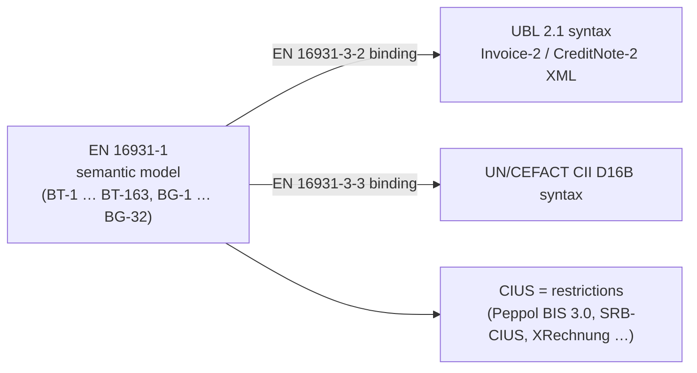

# Learning note 02 — UBL 2.1, EN 16931 and how the two relate

## Three layers of "what is an invoice"

1. **Semantic model (EN 16931-1).** A list of *business terms* ("BT") grouped into *business
   groups* ("BG"): `BT-1` invoice number, `BT-2` issue date, `BG-4` seller, `BG-22` document
   totals, `BG-23` VAT breakdown, `BG-25` invoice line. It defines cardinality (`1..1`,
   `0..n`), data types (Amount, Quantity, Code, Date, Identifier) and about 150 business
   rules (`BR-*`, `BR-CO-*`, `BR-S-*` …). It says nothing about XML.
2. **Syntax bindings (EN 16931-3-x).** A table that says where each BT lives in a concrete
   XML vocabulary. For UBL: `BT-1 → /Invoice/cbc:ID`, `BT-116 → cac:TaxTotal/cac:TaxSubtotal/cbc:TaxableAmount`.
   The same semantics can be carried by UBL or by CII.
3. **CIUS (Core Invoice Usage Specification).** A *restriction* of the core model for one
   country or network: it may make optional terms mandatory, restrict code lists or add
   rules, but may never add new terms or relax the core. Peppol BIS Billing 3.0 is a CIUS;
   the Serbian SRB-CIUS used by SEF is another. A CIUS-compliant invoice is always
   EN 16931-compliant; the reverse is not guaranteed.

## UBL 2.1 in two minutes

UBL (Universal Business Language, OASIS, ISO/IEC 19845) is a library of XML schemas for
business documents. The parts that matter here:

- Two root documents: `Invoice` (namespace `…:xsd:Invoice-2`) and `CreditNote`
  (`…:xsd:CreditNote-2`).
- Two shared namespaces: `cbc` (*Common Basic Components*: leaf values such as `cbc:ID`,
  `cbc:IssueDate`, `cbc:Amount`) and `cac` (*Common Aggregate Components*: structures such as
  `cac:Party`, `cac:TaxTotal`, `cac:InvoiceLine`).
- Amounts carry `currencyID`, quantities carry `unitCode`, identifiers carry `schemeID`.
- The schema fixes element *order* and *cardinality* but is permissive about content: it
  requires surprisingly little (`cbc:ID`, `cbc:IssueDate`, the two parties, a payable amount,
  one line). Almost everything EN 16931 calls mandatory is optional in the raw schema — which
  is why XSD validation alone says very little, and Schematron carries the business rules.
- Credit notes are structurally almost identical but rename a few elements:
  `cac:CreditNoteLine`, `cbc:CreditedQuantity`, `cbc:CreditNoteTypeCode`, and there is no
  `cbc:DueDate` at the root (EN 16931 puts `BT-9` on `cac:PaymentMeans/cbc:PaymentDueDate`).

## How SEF Kopilot uses this

- `einvoice_core.model` *is* the semantic model: field = business term, group = business
  group. The syntax never leaks above the parser (ADR-0003).
- `einvoice_core.ubl` *is* the EN 16931-3-2 binding, written as code: one function per
  business group, reading the UBL elements the binding names.
- Validation then happens on both representations: XSD and Schematron on the XML tree
  (syntax and the published rules), arithmetic and SRB-CIUS rules on the model (in Python,
  with `Decimal`). Both report locations as canonical XPaths into the same tree.

## Worth knowing for an interview

- *"Why not generate classes from the XSD?"* — Because rules and regulations are written in
  business terms, not in `PartyTaxSchemeType`; and because a second syntax (CII, PDF) would
  need a second rule set. One semantic model, several bindings.
- *"Why keep the XML tree at all?"* — Schematron runs on it, violations point into it, and
  patches are applied to it. The model is for reasoning; the tree is the thing being fixed.
- *"What does a CIUS forbid?"* — Adding terms or relaxing the core. It can only restrict.
  That is why an SRB-CIUS rule set is a layer *on top of* EN 16931, never a replacement.
- *"Why `Decimal`?"* — `0.1 + 0.2 != 0.3` in binary floating point; EN 16931 arithmetic rules
  compare amounts to the cent, so the engine never lets an amount become a `float`.
